  

  
  
  
  

  

---

## About

- 🎓 B.E. **Artificial Intelligence & Data Science**, Chaitanya Bharathi Institute of Technology (CBIT), Hyderabad — **8.80/10 CGPA**
- 💼 Selected for the **Evernorth (Cigna) AI/ML Industry Training Program (2026)** — deep learning, GenAI, NLP, and healthcare analytics
- 📊 I turn **raw data → reliable analytical systems → actionable business decisions**
- 🟢 **Open to internships** in Data Engineering, Data Analytics, BI, and Machine Learning

---

## ⭐ Flagship Systems

### 🏥 [Healthcare Analytics & Business Intelligence System](https://github.com/Hemanthsai456/sparcs-healthcare-bi-platform)
*A dimensional data warehouse and BI platform on PostgreSQL 18, turning 7 years of NYS hospital discharge data into decision-ready analytics.*

`RAW DATA → STAGING → ETL + VALIDATION → STAR SCHEMA → SQL ANALYTICS → POWER BI`

**Warehouse design**
- Star schema with **8 dimension tables and 1 fact table**; fact grain is one inpatient discharge event
- Reusable multi-year **ETL pipeline** with surrogate keys, audit logging, and post-load validation
- **11 analytics views + 6 materialized views**, tuned with indexing and `EXPLAIN ANALYZE`

**Scale & output**

| Records | Years | Schema | Views | Dashboard |
|:---:|:---:|:---:|:---:|:---:|
| 16.3M+ | 7 | 8 dims + 1 fact | 11 + 6 mat. | 8-page Power BI |

`PostgreSQL` `SQL` `ETL` `Star Schema` `Power BI` `DAX`

[Repository](https://github.com/Hemanthsai456/sparcs-healthcare-bi-platform) · [Case Study](https://github.com/Hemanthsai456/sparcs-healthcare-bi-platform/tree/main/DOCS)

 

### 📦 [Medical Inventory Forecasting & Decision Support System](https://github.com/Hemanthsai456/Medical-Inventory-Forecasting-Decision-Support-System)
*An end-to-end ML system that forecasts demand and turns predictions into procurement decisions.*

`DATA → PREPROCESSING → FEATURE ENGINEERING → 14-MODEL COMPARISON → FORECASTING → EXPLAINABILITY → DECISION SUPPORT`

**Model performance** — R² **0.7978** · RMSE **9.692** · MAE **4.415**

**Beyond the model**
- Benchmarked **14 ML and ensemble models**, then tuned the best one
- **SHAP** explainability for global and local prediction interpretation
- **K-Means segmentation** → demand classification → inventory risk → procurement recommendations
- Deployed as an 8-page **Streamlit** decision-support app

`Python` `Scikit-learn` `XGBoost` `SHAP` `Streamlit`

[Repository](https://github.com/Hemanthsai456/Medical-Inventory-Forecasting-Decision-Support-System) · [Live Demo](https://hemanthsai-medical-inventory-decision-support.streamlit.app/) *(free-tier hosting — may take ~30s to wake)*

 

### 🎬 [Multimodal Cold-Start Movie Recommender](https://github.com/Hemanthsai456/Multimodal-Cold-Start-Movie-Recommender)
*A deep learning recommender that fuses CLIP poster and VGGish trailer-audio embeddings to recommend movies with no rating history.*

- Trained on **MovieLens 20M** with **19,232 movies**; compared 5 approaches including Neural Collaborative Filtering
- Multimodal model: MAE **0.6622**, RMSE **0.8523**
- Cold-start model for **2,107 unseen movies** cut MAE by **19.81%** and RMSE by **21.35%** versus the global-mean baseline

`Python` `TensorFlow` `Keras` `CLIP` `VGGish` `Streamlit`

[Repository](https://github.com/Hemanthsai456/Multimodal-Cold-Start-Movie-Recommender) · [Live Demo](https://hemanth-cold-start-user-based-movie-recommendation.streamlit.app/) *(free-tier hosting — may take ~30s to wake)*

---

## More Strong Projects

| Project | What it does | Key Technologies |
|---|---|---|
| 🚀 [**NIDHI — AI Investor Super App**](https://github.com/Hemanthsai456/NIDHI) · [Live](https://nidhiapp.vercel.app) | Team of 4. Unifies 7 asset classes in one portfolio with health, diversification and liquidity scores, and a Gemini assistant grounded in the user's own holdings | React • TypeScript • FastAPI • PostgreSQL • Firebase • Gemini |
| 🖥️ [**Data Center Resource Analytics**](https://github.com/Hemanthsai456/Data-Center-Resource-Analytics) | 2.7M-row server telemetry linked to heat load and cooling-water demand with a leakage-free model (R² 0.98) | Python • Scikit-learn • Pandas • Plotly |
| 🧠 [**Human Decision Intelligence**](https://github.com/Hemanthsai456/Human-Decision-Intelligence) | Explainable modeling of 105K human decisions under risk (70.95% accuracy, 0.79 ROC-AUC) with SHAP and LIME | R • Shiny • XGBoost • SHAP |
| 📈 [**ProfilePulse** *(Beta)*](https://github.com/Hemanthsai456/ProfilePulse) | Privacy-first visitor badge service for GitHub profile READMEs (the badge on this page). Counts GitHub Camo proxy requests with daily-rotating HMAC visitor keys, no stored IPs or User-Agents, 30-day retention, and rate limiting | Python • FastAPI • PostgreSQL • Docker • pytest |

---

## Tech Stack

**Programming & Querying**

**Data Engineering & Databases**

**Data Analysis & BI**

**Machine Learning & Deep Learning**

**Development & Deployment**

---

## Current Focus

- 🗄️ **SQL & Data Engineering:** Advanced SQL, PostgreSQL, ETL design, and data modeling
- 💻 **DSA:** Problem-solving practice on LeetCode
- 🧠 **ML / DL / AI:** Model evaluation, explainability, and ML system design through the Evernorth training program
- 📐 **Aptitude & Communication:** Logical reasoning, quantitative aptitude, maths, and clear technical communication

---

## GitHub Activity

  <picture>
    <source media="(prefers-color-scheme: light)" srcset="./assets/profile/contributions.light.svg">
    
  </picture>

---

## Let's Connect

  <b>Looking for a Data / ML intern?</b> 
  I'm happy to walk through any project here: the data, the methods, and what I'd change next time.

  
  
  
  

  📍 Hyderabad, India · 🕐 Usually replies within 24–48 hours

  Building data and ML systems that turn real-world problems into actionable decisions.

